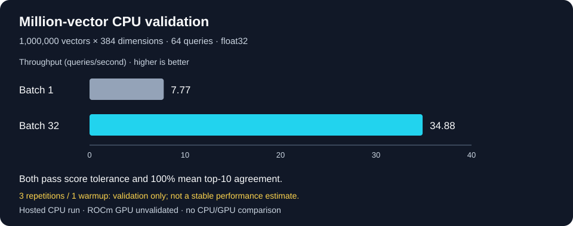

# Bastion Helix — ROCm Evidence Lab

**Measure batching gains. Check correctness. Publish reproducible evidence.**

A working developer-tool prototype for the cosine-scoring stage of vector retrieval. It compares one-query-at-a-time execution against batches, checks scores and top-k agreement, and generates a self-contained HTML report plus raw JSON. Built for an AMD Developer Community showcase; selection is not guaranteed.

## Current evidence

**CPU evidence is published. ROCm GPU validation is pending.** Two saved CPU runs demonstrate execution and correctness; neither establishes AMD GPU performance.



| Million-vector trial | Batch 1 | Batch 32 |
| --- | ---: | ---: |
| Median whole-workload time | 8237.670 ms | 1834.898 ms |
| Throughput | 7.77 queries/s | 34.88 queries/s |
| Score tolerance | Pass | Pass |
| Mean top-10 set agreement | 100% | 100% |

The measured batching ratio was **4.49×** in this hosted CPU trial, using just **3 repetitions and 1 warmup**. This is execution validation, not a stable performance estimate. Results vary with hardware, libraries and load; no CPU/GPU crossover has been measured. See [raw samples and environment](results/million-cpu-01/measurements.json) and [trial notes](results/million-cpu-01/README.md).

The [original smaller CPU run](results/measurements.json) measured approximately 1.94× throughput with batch 32. These are different workloads, so do not compare their speedup ratios as a scaling trend. The ROCm code path has **not yet been executed or validated on an AMD GPU**.

### Reproduce the million-vector validation

After installing dependencies below, run from the repository root:

```sh
OPENBLAS_NUM_THREADS=1 python sweep.py --backend cpu --sizes 1000000 --batches 32 --queries 64 --dim 384 --repeats 3 --warmup 1 --output validation-million-cpu-02
```

On Windows PowerShell, set `$env:OPENBLAS_NUM_THREADS="1"` first and omit the environment prefix. Use a fresh output directory for each trial. Open `validation-million-cpu-02/docs-1000000-batch-32/report.html`; its neighboring `measurements.json` retains raw timings and correctness checks. This reproduces the configuration, not identical timing. For stronger timing evidence, use `--repeats 30 --warmup 5` and retain multiple independent trials.

The corpus alone needs about 1.43 GiB; the saved run estimated about 2.46 GiB of host memory including working space and headroom. Actual peak memory can differ. The default budget is 4096 MiB; review the memory notes below before running.

## Quick start (Python 3.10+)

```sh
python -m venv .venv
# Linux/macOS:
source .venv/bin/activate
# Windows instead: .venv\Scripts\activate
python -m pip install -r requirements.txt
OPENBLAS_NUM_THREADS=1 python evidence_lab.py --backend cpu --output results-cpu
python -m unittest -v
```

On Windows PowerShell set `$env:OPENBLAS_NUM_THREADS="1"` then run the Python command without the environment prefix. Open `results-cpu/report.html` in a browser. No web server, API account, paid model or network connection is needed after installation.

## Run on AMD

Use your own supported AMD machine or an authorized AMD Developer Cloud environment. Do not use a certification lab for unrelated workloads unless its terms permit it. Cloud access, quotas and charges depend on your account; this project does not provision compute.

1. Match your GPU, operating system and ROCm/PyTorch build against AMD's current compatibility documentation.
2. Install the matching ROCm PyTorch build using AMD's official instructions. Installing generic `torch` alone does not establish ROCm support.
3. Install NumPy and copy this folder into that environment.
4. Run:

```sh
python evidence_lab.py --backend rocm --docs 4096 --queries 64 --dim 384 --batch 32 --repeats 30 --warmup 5 --output results-rocm
```

The command refuses to silently fall back to CPU. It requires both a HIP-enabled PyTorch build and an available device. `torch.cuda` is the API name used by ROCm PyTorch too. Device synchronization surrounds wall-clock timing; input transfer and accuracy validation occur outside timed sections.

For larger experiments, increase `--docs` gradually and record every configuration. The tool checks a configurable memory estimate before allocating data. If memory is exhausted, reduce docs, queries or dimension. Do not change results or mark a failed quality check as passing.

## What is implemented

- Seeded, normalized float32 synthetic embeddings with a SHA-256 dataset fingerprint.
- NumPy CPU and optional PyTorch ROCm implementations of cosine scoring.
- Batch-1 baseline and configurable batched candidate, including partial final batches.
- Warmups, alternating execution order, individual samples, median and p95.
- Numerical tolerance check and top-k set agreement against CPU reference.
- Recommendation restricted to passing candidates; it can recommend batch 1.
- Portable HTML report, raw measurements, local notebook and tests.

## Methodology and limits

The experiment scores all queries against all documents in memory. It includes matrix multiplication, concatenation, Python dispatch and synchronization, but excludes generating embeddings, host-to-device transfer, top-k selection and queueing. P95 is across repeated whole-workload runs, not production request latency. Throughput is queries divided by total run time. Candidate and baseline use the same backend and dtype.

Correctness requires `allclose(atol=1e-4, rtol=1e-3)` and mean top-k set agreement ≥99%. Near-ties can change rankings; inspect failures rather than loosening tolerances to create a favorable result. Synthetic random vectors test numerical consistency, not whether search results are meaningful. This is not an end-to-end RAG benchmark or proof that batching always helps. Whole score matrices are materialized, so it is not a billion-document retrieval engine.

Automated tests exercise corrupted rankings, remainder batches, deterministic datasets, sample counts and invalid k. A complete CPU run also passed. GPU execution remains unverified. Benchmark values are not signed or tamper-proof: dataset hashes support reproduction, not independent attestation.

## Next milestones

1. Run three independent ROCm experiments on the same GPU with 30 repetitions each; retain all runs, including regressions.
2. Sweep at least three query counts and batch sizes. Explain throughput versus waiting-time tradeoffs.
3. Extend the benchmark to a licensed public document corpus and a fixed open embedding model; report retrieval quality separately from numeric agreement.
4. Record a 90-second screen demo: environment → run → correctness → report → limitations.
5. Keep source, setup instructions, hardware/software versions and raw results together as new trials are published.
6. Update the Showcase discussion with verified AMD results.

Showcase discussion: https://devcommunity.amd.com/t/bastion-helix-rocm-evidence-lab-correctness-first-vector-retrieval-benchmarking/1382

## Product direction

An evidence-producing performance companion for developers moving retrieval and AI services onto AMD. Subsequent milestones: real embedding inputs; chunked top-k to bound memory; paired repeated-trial confidence intervals; validated FP16/BF16 accuracy tradeoffs; profiler trace export; optional read-only MCP tools to inspect saved run results. These are roadmap items, not implemented features.

## Sources

- PyTorch HIP semantics: https://docs.pytorch.org/docs/stable/notes/hip.html
- Synchronization and timing: https://docs.pytorch.org/docs/stable/notes/cuda.html
- AMD PyTorch installation: https://rocm.docs.amd.com/projects/install-on-linux/en/latest/install/3rd-party/pytorch-install.html
- AMD developer showcase: https://devcommunity.amd.com/c/general/showcase/19

Independent Bastion Helix project. AMD and ROCm names identify the target platform only.

## Corpus and batch sweeps

The default sweep covers 4,096, 32,768, 131,072 and 1,000,000 vectors, at batch sizes 1, 8, 32 and 64. Defaults: dimension 384, 64 queries, 30 repetitions and 5 warmups. Every candidate has a batch-1 baseline on the same backend.

```sh
# Plan without allocating vectors or using a GPU
python sweep.py --dry-run --output plan-01
# Run separately on adequately provisioned machines
OPENBLAS_NUM_THREADS=1 python sweep.py --backend cpu --output sweep-cpu-01
OPENBLAS_NUM_THREADS=1 python sweep.py --backend rocm --output sweep-rocm-01
```

On Windows, set the environment variable separately as described above. Customize with `--sizes`, `--batches`, `--queries`, `--dim`, `--repeats`, `--warmup` and `--timeout`. Keep thread settings consistent; results capture the thread environment variables, not a guarantee of actual library thread counts.

Each configuration runs in an isolated process. Its log, JSON and HTML report are retained. Failed runs and timeouts are recorded in `summary.json` and cause a nonzero sweep exit code. Existing output directories are refused so earlier trials are not overwritten.

### Memory and validation limits

The default `--memory-budget-mib 4096` applies separately to estimated host and device memory. A million 384-dimensional float32 vectors alone occupy about 1.43 GiB. Generation uses bounded blocks, hashing avoids corpus-sized byte copies, and correctness validation sorts one query at a time. Full score matrices are still materialized.

Memory estimates include working space and headroom but are not hard limits: library workspaces, allocator caching and other processes can still cause allocation failure. ROCm additionally checks the estimate against currently free GPU memory. Reduce sizes or raise the budget only on adequately provisioned hardware.

Five unit tests pass. Small and medium CPU sweeps passed, the default 16-configuration dry run completed, and an intentionally insufficient budget was rejected and logged. A million-vector CPU validation now passes; AMD GPU execution remains unvalidated. The bundled `results/` still contains the original CPU run; no GPU speedup or CPU/GPU crossover is claimed.

## Million-vector CPU validation

[Raw results and reproduction notes](results/million-cpu-01/README.md): 1,000,000 vectors × 384 dimensions, 64 queries, batches 1 and 32. Both passed numerical tolerance and 100% top-10 agreement. Median times were 8,237.670 ms and 1,834.898 ms respectively (4.49× throughput). This hosted-CPU run has only three repetitions and one warmup; it validates execution and correctness, not a stable performance estimate. GPU validation is still pending.
